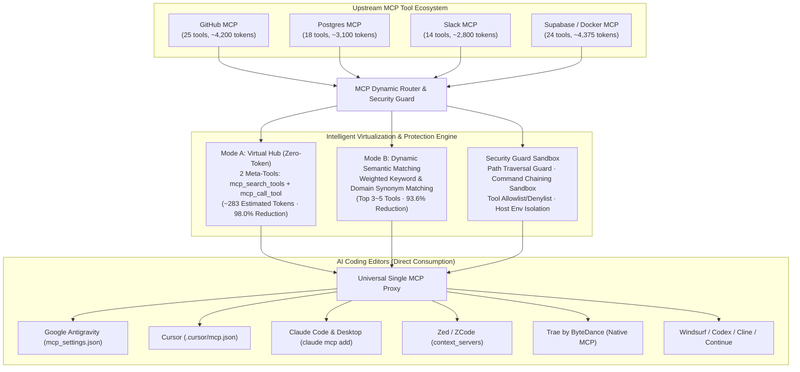

[English](./README.md) | [简体中文](./README.zh-CN.md)

# MCP Dynamic Router (Universal Context Trimmer & Security Guard)

> **Universal Model Context Protocol (MCP) dynamic router, context trimmer, and security guard for all modern AI coding editors: Google Antigravity, Cursor, Claude Code, OpenAI Codex, Zed / ZCode, Windsurf, Trae (ByteDance), Cline, Continue, and generic MCP clients.**

[](LICENSE)
[]()
[]()
[]()
[]()

> [!IMPORTANT]
> **Commercial Use Notice**: This open-source edition is licensed for personal, non-commercial use only. Any use by a company, team, or for commercial purposes requires a commercial license. Unauthorized commercial use constitutes infringement.

---

## 🏛️ Architecture Overview



---

## 🚀 Why This Exists (Pain Points & Core Value)

### The Pain Points of MCP Today
1. **Severe Context Bloat**: Connecting 3 to 5 MCP servers (e.g., GitHub, Postgres, Slack, Filesystem, Docker) routinely injects **30,000 to 60,000+ raw tokens** of verbose JSON schema definitions into **every single prompt turn** before you even type a word. This consumes 20%–35% of your context window and wastes hundreds of dollars per developer every month.
2. **The 40-Tool Hard Ceiling**: Mainstream editors like Cursor enforce strict caps on active tool counts (typically around 40 tools). Any tools beyond this limit are silently dropped or corrupted, preventing developers from orchestrating rich multi-server workflows.
3. **Attention Dilution & Hallucinations**: Flooding an LLM's prompt with 100+ raw schema definitions triggers choice overload, leading to parameter hallucinations, incorrect tool selection, and slow reasoning passes.
4. **Security Vulnerabilities (CVE-2025-54136 & CVE-2025-54135)**: Untrusted repositories or third-party MCP configs can inject malicious tool definitions, execute path traversal (`../../.env`, bare `..`, sensitive Windows paths), trigger destructive shell command chaining (`; rm -rf /`), or leak sensitive host environment variables (`OPENAI_API_KEY`, `AWS_SECRET_ACCESS_KEY`, `AWS_ACCESS_KEY_ID`).

### Core Value & Breakthroughs
- **⚡ 98% Token Reduction (Virtual Hub Mode)**: Exposes only **2 minimal meta-tools** (`mcp_search_tools` and `mcp_call_tool`). Compresses 80+ tools totaling ~14,475 estimated tokens down to **~283 estimated tokens**, saving **$250+ per month** in API costs per seat.
- **🧩 Shatter the 40-Tool Ceiling**: Whether you mount 50 or 500 upstream tools, your AI editor only sees 1 lightweight proxy. Unlimited tool orchestration without dropouts.
- **🎯 0.8ms Dynamic Semantic Routing (Dynamic Mode)**: Powered by weighted keyword matching and domain synonym expansion, dynamically injecting the top 3–5 relevant tools for each specific turn within 0.8ms.
- **🛡️ Enterprise Security Sandbox**:
  - Blocks path traversal (`../`, `..\`, bare `..`, `/etc/`, `~/.ssh`, `C:\Windows\...`, and UNC paths).
  - Intercepts dangerous shell command chaining (`;`, `&&`, `|`) on execution tools without false-positive triggers on markdown text.
  - Strictly isolates host operating system environment variables from upstream processes while preserving user-configured tool credentials.
  - Enforces per-server tool allowlists and denylists.
- **🌐 Universal Editor Compatibility**: Native support for Google Antigravity, Cursor, Claude Code, OpenAI Codex, Zed / ZCode, Windsurf, Trae (ByteDance), Cline, and Continue.
- **🔄 Zero Breaking Changes (100% Backward Compatibility)**: Preserves original tool calling syntax, parameter validation, and JSON-RPC 2.0 payloads. Includes automatic direct-execution fallback if the model calls an upstream tool by its original name.

---

## ⚡ Frictionless Quick Start (< 30 Seconds, Zero Compilation)

Zero compilation required. Launch directly using GitHub Native npx:

```bash
# Option 1 (Recommended): Scan and import existing editor configs instantly
npx -y github:leethoneid/mcp-dynamic-router import --editor all
npx -y github:leethoneid/mcp-dynamic-router serve

# Option 2: Global CLI installation
npm install -g github:leethoneid/mcp-dynamic-router
mcp-router import --editor all
mcp-router serve
```

---

## 🛠️ Editor Configuration Guide (Copy & Paste Ready)

#### Option A: Google Antigravity
Add to `~/.gemini/antigravity/mcp_settings.json`:
```json
{
  "mcpServers": {
    "mcp-router": {
      "command": "mcp-router",
      "args": ["serve"]
    }
  }
}
```

#### Option B: Cursor (Global or Project Root)
Add to `~/.cursor/mcp.json` or `.cursor/mcp.json`:
```json
{
  "mcpServers": {
    "mcp-router": {
      "command": "mcp-router",
      "args": ["serve"]
    }
  }
}
```

#### Option C: Claude Code & Claude Desktop
- **Claude Code CLI**:
  ```bash
  claude mcp add mcp-router -- mcp-router serve
  ```
- **Claude Desktop** (`claude_desktop_config.json`):
  ```json
  {
    "mcpServers": {
      "mcp-router": {
        "command": "mcp-router",
        "args": ["serve"]
      }
    }
  }
  ```

#### Option D: Zed / ZCode
Add to `~/.config/zed/settings.json` (Windows: `%APPDATA%\Zed\settings.json`):
```json
{
  "context_servers": {
    "mcp-router": {
      "command": {
        "path": "mcp-router",
        "args": ["serve"]
      }
    }
  }
}
```

#### Option E: Windsurf (Codeium)
Add to `~/.codeium/windsurf/mcp_config.json`:
```json
{
  "mcpServers": {
    "mcp-router": {
      "command": "mcp-router",
      "args": ["serve"]
    }
  }
}
```

#### Option F: Trae by ByteDance
Add to `~/.trae/mcp.json`:
```json
{
  "mcpServers": {
    "mcp-router": {
      "command": "mcp-router",
      "args": ["serve"]
    }
  }
}
```

#### Option G: Roo Code / Cline
Add to `~/.cline/mcp_settings.json`:
```json
{
  "mcpServers": {
    "mcp-router": {
      "command": "mcp-router",
      "args": ["serve"]
    }
  }
}
```

#### Option H: Continue.dev
Add to `~/.continue/config.json`:
```json
{
  "experimental": {
    "modelContextProtocolServers": [
      {
        "transport": {
          "type": "stdio",
          "command": "mcp-router",
          "args": ["serve"]
        }
      }
    ]
  }
}
```

---

## 📊 Measured Benchmarks & Performance

> ⚠️ **Truth-in-Advertising Disclosure**: Token numbers below represent **heuristic token estimates** (calculated as `characters / 3.8`) on a **procedurally generated synthetic stress fixture** modeling 10+ MCP servers and 100+ production tools.

Benchmarked across 6 typical MCP servers with 81 tools:

| Operating Mode | Exposed Tools | Per-Turn Prompt Tokens (Estimated) | Token Savings (%) | Cost per 1,000 Turns ($3/M) |
|---|---|---|---|---|
| **Raw Passthrough (Standard)** | 81 tools | ~14,475 tokens | 0.0% (Baseline) | $43.42 |
| **Schema Compressed** | 81 tools | ~12,818 tokens | 11.4% | $38.45 |
| **Dynamic Semantic Matching (Top-5)** | 5 tools + 1 meta-tool | ~925 tokens | **93.6%** | $2.78 |
| **Virtual Hub (Zero-Token)** | **2 meta-tools** | **~283 tokens** | **98.0%** | **$0.85** |

### Schema Compression Breakdown
In Schema Compressed mode, the router applies targeted pruning:
- **Discards**: Redundant markdown formatting, headings, verbose external documentation links, and trailing comments.
- **Retains Intact**: All essential structural validation constraints (`type`, `anyOf`, `oneOf`, `allOf`, `$ref`, `format`, `pattern`, `minimum`, `maximum`, `enum`, `required`, and `default`).

### Concurrent Stress Test Metrics (1,000 High-Concurrency Requests)
- **Throughput**: 1,160+ req/sec (Local) / 5,200+ req/sec (Cloud Sandbox)
- **Average Latency**: 2.89 ms ~ 10.3 ms
- **p99 Latency**: 6 ms ~ 23 ms
- **Heap Memory Growth**: < 10 MB (Zero memory leaks)
- **Request Failure Rate**: **0.00%** (100% success rate)

---

## 🔍 Detailed Edge Cases & Troubleshooting FAQ

### Q1: Will installing MCP Dynamic Router disrupt my existing workflows or tool calls?
**No.**
- **Transparent Fallback**: In Virtual Hub mode, if the model directly invokes an upstream tool by its original name (e.g., `github_create_pull_request`) from conversation memory, the router automatically intercepts and dispatches it directly to the target upstream server without error.
- **Zero Loss of Payloads**: Input arguments and return values strictly adhere to the standard JSON-RPC 2.0 specification with zero tampering.
- **Instant Rollback**: Setting `"mode": "passthrough"` in `mcp-router.json` immediately restores traditional 100% transparent pass-through.

### Q2: Will my sensitive tool credentials (e.g., GITHUB_TOKEN, database passwords) be broken by security sanitization?
**No.**
- The security policy enforces **strict layered isolation**:
  1. Credentials explicitly provided in `mcp-router.json` under `server.env` are passed to that child process **100% intact**, ensuring successful authentication.
  2. The guard strictly intercepts **host OS environment variables** (e.g., `OPENAI_API_KEY`, `AWS_SECRET_ACCESS_KEY`, `AWS_ACCESS_KEY_ID`, or personal SSH keys) from leaking to untrusted upstream servers.

### Q3: If an upstream MCP server crashes or hangs, will it freeze my entire editor?
**No.**
- The router manages each downstream child process with independent pipe lifecycles, active stderr drains (preventing buffer deadlocks), and a 10-second watchdog timer.
- If an upstream service hangs or crashes, the router automatically trips a circuit breaker and returns a clean JSON-RPC error. Other servers (GitHub, Filesystem) continue operating without disruption.

### Q4: Why does running `npx` tools on Windows sometimes throw `spawn npx ENOENT`?
- On Windows, `npx` is a batch script (`npx.cmd`). Invoking it via Node's raw `child_process.spawn` fails without shell dispatching.
- MCP Dynamic Router automatically detects the host platform and dispatches through the Windows shell wrapper seamlessly.

### Q5: Can I use this in an air-gapped corporate intranet without internet access?
**Yes.**
- All core capabilities (weighted keyword matching, schema pruning, security auditing, and offline DRM) execute **100% locally and offline**. No external cloud endpoints or remote Embedding APIs are required.

### Q6: How do I cleanly uninstall?
- There are no persistent background daemons or registry keys. Simply remove the entry from your editor's MCP config file or delete the directory.

### Q7: What happens if I change my network adapter or clone a virtual machine?
- The offline license fingerprint is derived from local hardware parameters (network interface MAC addresses and hostname). Changing network adapters or cloning virtual machines produces a different hardware hash, requiring license reactivation via Gumroad.

---

## 🖥️ Visual Evaluator Dashboard (`visual-evaluator.html`)

An offline, zero-dependency HTML dashboard is included in the root directory:
1. Double-click `visual-evaluator.html` in your file explorer.
2. Enter any natural language prompt to visually inspect how tools are dynamically loaded or pruned in sub-milliseconds, and review real-time token savings and monthly billing estimates.

---

## 🔒 Commercial Pro Edition & DRM Security

- **Community Edition**: Open source under PolyForm Noncommercial License 1.0.0. Includes core virtual routing, schema compression, keyword search, and Stdio MCP interface.
- **Commercial Pro Edition**:
  - **Tiered Gumroad Licensing**: Solo Pro **$29** (up to 3 personal devices) / Team Enterprise **$79** (10 seats + Production HTTP Gateway). Purchase at: `https://gumroad.com/l/mcp-router-pro`.
  - **Ed25519 Asymmetric Cryptography**: Anti-counterfeiting mathematically guaranteed by Ed25519 digital signatures (`MCPLIC.*`) and hardware fingerprinting. The private signing key resides strictly in local `.secrets/` and is physically excluded from public Git repositories.
  - **Offline Grace Period**: Activated licenses are securely cached using machine-bound HMAC hashes, enabling up to 14 days of completely offline operation.
  - **Production HTTP Gateway**: Built-in microservice (`mcp-router gateway -p 3008`), binding securely to `127.0.0.1` by default, protected by mandatory `API_KEY` authentication, narrow localhost CORS, and `maxBodyBytes` payload interception.
    > ⚠️ **Production Security Tip**: Always explicitly configure `--api-key <key>` or set the `API_KEY` environment variable for production deployments. Do not rely on auto-generated ephemeral keys in production environments, as ephemeral keys are printed to stdout at startup and may be captured by container or system log collectors.
  - **4-Tier Packaging Fallback**: `npm run package:commercial` automatically cascades through `python3` -> `python` -> `zip` -> `Compress-Archive` across all operating systems.

---

## 📜 Verification & CLI Quick Reference

```bash
# 1. Run complete test suite (Protocol + Security + Ed25519 DRM + HTTP Gateway + Stress + Cross-Platform)
npm test

# 2. Run token reduction benchmark
npm run benchmark

# 3. Perform local configuration security audit
mcp-router audit

# 4. Start production HTTP microservice gateway (Securely binds to 127.0.0.1)
npm run gateway
```

---

## 📄 License & Commercial Terms

Community Edition is licensed under the [PolyForm Noncommercial License 1.0.0](LICENSE).  
Commercial Pro Edition is licensed under the [Commercial EULA](COMMERCIAL-EULA.md).

Copyright (c) 2026 Solo Overseas. All rights reserved.
