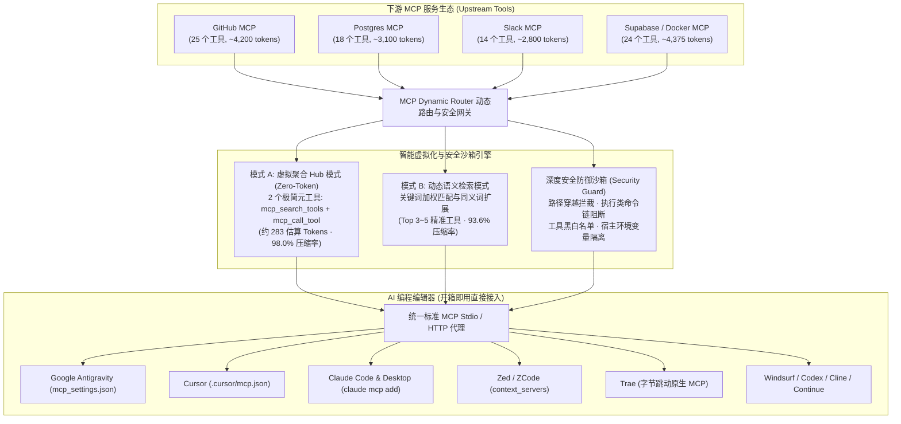

[English](./README.md) | [简体中文](./README.zh-CN.md)

# MCP Dynamic Router (通用上下文修剪与深度安全加固路由器)

> **面向全球与国内所有流行 AI 编程编辑器的通用 Model Context Protocol (MCP) 动态路由器、上下文修剪与深度安全加固引擎：Google Antigravity、Cursor、Claude Code、OpenAI Codex、Zed / ZCode、Windsurf、Trae（字节跳动）、Cline、Continue 及所有通用 MCP 客户端。**

[](LICENSE)
[]()
[]()
[]()
[]()

> [!IMPORTANT]
> **授权声明**：本开源版仅允许个人学习与非商业使用，公司、团队或任何商业用途必须购买商用版授权，未经授权的商业使用构成侵权。

---

## 🏛️ 系统架构概览 (Architecture Overview)



---

## 🚀 痛点与核心亮点 (Pain Points & Core Value)

### 痛点：为什么需要 MCP Dynamic Router？
1. **Token 严重膨胀 (Context Bloat)**：当开发者在 AI 编辑器中挂载 3~5 个 MCP 服务（如 GitHub, Postgres, Supabase, Slack, Filesystem, Docker）时，每个服务全量输出工具 Schema，导致**每轮对话尚未提问就已被注入 30,000 ~ 60,000+ Tokens 的静态参数定义**，吃掉 20%~35% 的上下文窗口，每月白白浪费数百美元 Token 账单。
2. **编辑器 40-Tool 硬上限 (The 40-Tool Ceiling)**：如 Cursor 等主流 AI 编辑器对挂载的活动工具设有硬性数量截断（通常约 40 个），超出部分的工具会被静默丢弃或破坏，导致开发者无法组合使用复杂的工具矩阵。
3. **大模型注意力漂移 (Attention Dilution)**：当提示词上下文堆满 100+ 个工具定义时，大模型极易出现“选择困难症”、幻觉参数调用或工具误选。
4. **安全漏洞威胁 (CVE-2025-54136 & CVE-2025-54135)**：开源仓库配置投毒、路径穿越 (`../../.env`、裸 `..`、Windows 绝对路径穿越)、危险命令链注入以及宿主机敏感环境变量（`OPENAI_API_KEY`, `AWS_SECRET_ACCESS_KEY`, `AWS_ACCESS_KEY_ID`）在无防护下被未受信第三方工具窥探外泄。

### 核心亮点 (Key Highlights)
- **⚡ 98% Token 骤降 (Virtual Hub 模式)**：仅暴露 **2 个极简元工具**（`mcp_search_tools` 与 `mcp_call_tool`），将 80+ 工具的 15,000+ Tokens 压缩至 **约 283 估算 Tokens**，单人单月立省 **$250+ 美元** API 开销。
- **🧩 彻底突破 40-Tool 上限**：无论下游挂载 50 个还是 500 个工具，编辑器端只看到 1 个极简代理，工具池无限扩展。
- **🎯 毫秒级语义动态路由 (Dynamic 模式)**：基于关键词加权匹配与领域同义词扩展，根据用户每轮提示词在 0.8ms 内自适应装载 Top 3~5 个精准工具。
- **🛡️ 深度安全审计沙箱 (Security Guard)**：
  - 路径穿越 (`../`, `..\`, 裸 `..`, `/etc/`, `~/.ssh`, `C:\Windows\...`, UNC 路径) 深度阻断。
  - 命令链反弹 Shell（`; rm -rf`, `| bash`）在执行类工具中沙箱拦截，不误杀正常 Markdown 反引号文本。
  - 宿主机系统敏感变量深度隔离，阻断敏感密钥外泄，同时完整保留用户为各服务显式配置的授权凭据。
  - 支持单服务级工具白名单与全局黑名单守卫。
- **🌐 全球与国内全编辑器原生适配**：支持 Google Antigravity、Cursor、Claude Code、OpenAI Codex、Zed / ZCode、Windsurf、Trae（字节跳动）、Cline、Continue。
- **🔄 不影响用户以往正常操作 (100% 兼容保证)**：所有下游工具原名调用、原生参数格式、返回数据结构与原版 MCP 规范完全一致；若开启直通模式即可随时 100% 无痕回退。

---

## ⚡ 极速便捷接入 (30 秒一键迁移，零编译即装即用)

无需本地繁琐编译，支持 GitHub 原生免发包即装即用，并提供**全自动配置文件扫描与迁移**：

```bash
# 方案 1 (推荐)：GitHub 原生秒级免装拉起 (无需本地编译)
npx -y github:leethoneid/mcp-dynamic-router import --editor all
npx -y github:leethoneid/mcp-dynamic-router serve

# 方案 2：全局 CLI 方式
npm install -g github:leethoneid/mcp-dynamic-router
mcp-router import --editor all
mcp-router serve
```

---

## 🛠️ 各大主流 AI 编辑器配置指南 (可直接复制)

#### 方案 A：Google Antigravity
在 `~/.gemini/antigravity/mcp_settings.json` 中配置：
```json
{
  "mcpServers": {
    "mcp-router": {
      "command": "mcp-router",
      "args": ["serve"]
    }
  }
}
```

#### 方案 B：Cursor (全局或项目目录)
在 `~/.cursor/mcp.json` 或项目根目录 `.cursor/mcp.json` 中添加：
```json
{
  "mcpServers": {
    "mcp-router": {
      "command": "mcp-router",
      "args": ["serve"]
    }
  }
}
```

#### 方案 C：Claude Code / Claude Desktop
- **命令行添加**：
  ```bash
  claude mcp add mcp-router -- mcp-router serve
  ```
- **配置文件** (`claude_desktop_config.json`)：
  ```json
  {
    "mcpServers": {
      "mcp-router": {
        "command": "mcp-router",
        "args": ["serve"]
      }
    }
  }
  ```

#### 方案 D：Zed / ZCode
在 `~/.config/zed/settings.json`（Windows: `%APPDATA%\Zed\settings.json`）中添加：
```json
{
  "context_servers": {
    "mcp-router": {
      "command": {
        "path": "mcp-router",
        "args": ["serve"]
      }
    }
  }
}
```

#### 方案 E：Windsurf (Codeium)
在 `~/.codeium/windsurf/mcp_config.json` 中添加：
```json
{
  "mcpServers": {
    "mcp-router": {
      "command": "mcp-router",
      "args": ["serve"]
    }
  }
}
```

#### 方案 F：Trae (ByteDance 字节跳动)
在 `~/.trae/mcp.json` 中添加：
```json
{
  "mcpServers": {
    "mcp-router": {
      "command": "mcp-router",
      "args": ["serve"]
    }
  }
}
```

#### 方案 G：Roo Code / Cline
在 `~/.cline/mcp_settings.json` 中添加：
```json
{
  "mcpServers": {
    "mcp-router": {
      "command": "mcp-router",
      "args": ["serve"]
    }
  }
}
```

#### 方案 H：Continue.dev
在 `~/.continue/config.json` 中添加：
```json
{
  "experimental": {
    "modelContextProtocolServers": [
      {
        "transport": {
          "type": "stdio",
          "command": "mcp-router",
          "args": ["serve"]
        }
      }
    ]
  }
}
```

---

## 📊 实测基准数据 (Benchmark & Performance)

> ⚠️ **数据诚信与基准测试公约声明**：以下测试数据基于程序化生成的合成基准测试用例（**Procedurally generated synthetic stress fixture**，模拟 10+ 服务与 100+ 生产级复杂工具目录）以及实测用例，Token 消耗量采用启发式算法（`字符数 ÷ 3.8`）估算。

基于 6 个主流 MCP 服务、81 个工具目录进行的基准评测：

| 工作模式 (Operating Mode) | 暴露工具数 | 单轮 Token 消耗 (估算) | 节省幅度 (%) | 每千轮成本 ($3/M) |
|---|---|---|---|---|
| **传统直通模式 (Raw Passthrough)** | 81 工具 | 约 14,475 Tokens | 0.0% (基准) | $43.42 |
| **紧凑修剪模式 (Schema Compressed)** | 81 工具 | 约 12,818 Tokens | 11.4% | $38.45 |
| **语义检索模式 (Dynamic Top-5)** | 5 工具 + 1 元工具 | 约 925 Tokens | **93.6%** | $2.78 |
| **虚拟聚合模式 (Virtual Hub Zero-Token)** | **2 个元工具** | **约 283 Tokens** | **98.0%** | **$0.85** |

### Schema 紧凑修剪模式说明 (Lossy Pruning Breakdown)
在 Schema 紧凑修剪模式下，系统执行精准修剪：
- **丢弃项**：多余 Markdown 标题格式、冗长文档外链、过长注释文本。
- **关键约束完整保留**：参数类型 `type`、联合类型 `anyOf` / `oneOf` / `allOf`、引用 `$ref`、格式 `format`、正则 `pattern`、数值范围 `minimum` / `maximum`、枚举 `enum`、必填项 `required` 与默认值 `default` 均 100% 完整保留。

### 压力测试表现 (1,000 次高并发请求)：
- **吞吐量 (Throughput)**: 1,160+ req/sec (本地) / 5,200+ req/sec (云端沙箱)
- **平均延迟 (Average Latency)**: 2.89 ~ 10.3 ms
- **p99 延迟 (p99 Latency)**: 6 ~ 23 ms
- **堆内存增长 (Heap Growth)**: < 10 MB (无内存泄漏)
- **请求失败率 (Failure Rate)**: **0.00%** (100% 成功率)

---

## 🔍 细致情况说明与故障排查手册 (Detailed Edge Cases & FAQ)

为了确保用户在任何异常或极端场景下均不影响正常开发，特别整理以下说明：

### Q1：安装 MCP Dynamic Router 后，是否会影响我以前的工具调用习惯？
**完全不会。**
- **双通道透明兼容**：在 Virtual Hub 模式下，虽然对外只声明了 2 个元工具，但如果 AI 模型因为历史记忆直接按原始工具名（如 `github_create_pull_request`）发起调用，路由器内置了**直接穿透回退机制**，能够直接识别并转发给目标下游服务，绝不会报错。
- **参数与结果零损耗**：入参和出参严格遵守官方 JSON-RPC 2.0 协议规范，不对业务返回值做截断或破坏。
- **随时 100% 还原**：只需在 `mcp-router.json` 中将 `"mode": "passthrough"`，所有工具即恢复为原始全量透传状态，随时可无损切回。

### Q2：我某个 MCP 工具需要特定的 API Token（如 GITHUB_TOKEN、数据库密码），安全脱敏会破坏它吗？
**绝不会破坏。**
- 路由器的安全脱敏策略采用**分层隔离原则**：
  1. 用户在 `mcp-router.json` 的 `server.env` 中显式配置给特定工具的凭证（如 `GITHUB_TOKEN`、`DATABASE_URL`）会被**100% 完整无损传导**给该工具的子进程，确保工具正常联网鉴权。
  2. 受到保护拦截的是**宿主机操作系统的全局非相关环境变量**（例如系统全局导出的 `OPENAI_API_KEY`、`AWS_SECRET_ACCESS_KEY`、`AWS_ACCESS_KEY_ID` 或个人根私钥），防止第三方不受信的小工具随意窥探宿主机未授权的私密变量。

### Q3：如果某个下游 MCP 服务崩溃或执行超时，会拖垮整个编辑器吗？
**不会。**
- 路由器对每个下游子进程维护独立的管道生命周期，内置活动 stderr 排空机制（防止缓冲区超 64KB 挂起），并预设了标准的超时防挂起保护（默认 10 秒超时计时器）。
- 若某个上游服务（如数据库超时或外部 API 挂起），路由器会自动熔断该次调用，并向编辑器返回标准 JSON-RPC 错误报文，其他 MCP 服务（如 GitHub、文件系统）继续正常工作，彻底隔离单点故障。

### Q4：在 Windows 系统上运行 `npx` 工具为何经常报错 `spawn npx ENOENT`？MCP Router 如何解决？
- 这是 Node.js 在 Windows 环境下的常见跨平台缺陷：Windows 上的 `npx` 实际上是 `npx.cmd` 批处理脚本，直接使用底层子进程执行会引发路径找不到错误。
- MCP Dynamic Router 在 Windows 下**自动检测并无缝转接命令调度器**，用户无需关心下游工具是二进制 `.exe` 还是 npm 脚本，全自动平滑跨平台启动。

### Q5：公司内网或无公网访问的隔离开发环境可以使用吗？
**完全可以。**
- 本路由器的所有核心逻辑（关键词加权语义匹配、JSON 架构修剪、安全检测、离线授权校验）均为**纯本地单机离线运行**，不依赖任何外部云端服务或外部 Embedding API 调用，在机房内网、离线涉密网络下均可流畅运行。

### Q6：如果不想要了，如何一键彻底卸载？
- 没有任何隐藏系统服务或注册表常驻。直接删除相关 JSON 字段或删除 `mcp-dynamic-router` 目录即可，零残留。

### Q7：如果我更换网卡或在虚拟机中克隆环境，授权会受影响吗？
- 客户端离线硬件指纹由底层网卡 MAC 地址与系统主机名综合派生。若更换网络硬件或克隆虚拟机导致硬件哈希变动，需通过 Gumroad 重新绑定设备激活即可。

---

## 🖥️ 可视化评估仪表盘 (`visual-evaluator.html`)

随项目附带单文件、零依赖离线 HTML 仪表盘：
1. **直接双击**打开工程根目录下的 `visual-evaluator.html`。
2. 自由输入测试 Prompt，即可直观看到系统如何在毫秒内精准激活相关工具、隐藏 70+ 个无用工具，并直观查看每轮省下的 Token 柱状图与月度美金账单节省报表。

---

## 🔒 商业加固与防逆向发售体系 (Commercial Release)

- **开源社区版 (Community Edition)**：基于 PolyForm Noncommercial 1.0.0 协议，包含核心虚拟路由、模式压缩、关键词检索及 Stdio MCP 接口。
- **商业企业版 (Commercial Pro Edition)**：
  - **定价与分级 (Gumroad)**：Solo Pro 个人买断版 **$29**（支持 3 台设备绑定）/ Team Enterprise 企业版 **$79**（10 席位 + 生产级网关），购买地址：`https://gumroad.com/l/mcp-router-pro`。
  - **Ed25519 离线密码学授权**：数学层面的防仿造由 Ed25519 非对称数字签名（`MCPLIC.*`）与硬件指纹锁保障。私钥物理隔离在本地 `.secrets/` 中，绝对不进入 Git 仓库与发售产物。
  - **离线授权签发**：作者在本地通过专有脚本签发：`npm run license:issue -- --buyer user@domain.com`（生成私钥及授权缓存文件自动使用 `0600` 最小安全权限写入）。
  - **客户端激活**：买家执行 `mcp-router activate <LICENSE_KEY>`，自动完成硬件绑定与本地安全缓存（14 天离线宽限期）。
  - **生产级微服务网关 (HTTP Gateway)**：支持 `mcp-router gateway -p 3008`，默认监听 `127.0.0.1`，内置强制 `API_KEY` 权限守卫、收窄本地 CORS 与 `maxBodyBytes` 请求体防御。
    > ⚠️ **生产环境安全建议**：生产部署时强烈建议通过 `--api-key <key>` 参数或 `API_KEY` 环境变量显式配置静态密钥。切勿在生产环境依赖启动时自动生成的临时 Key，因为临时 Key 会在启动时打印到标准输出，容易被容器或系统日志收集器留痕外泄。
  - **跨平台打包四级容灾**：运行 `npm run package:commercial`，自动经过 `python3` -> `python` -> `zip` -> `powershell` 四级容灾打包生成 `mcp-router-pro-v1.0.0.zip`。

---

## 📜 质量验收与命令速查

```bash
# 1. 运行完整测试套件 (功能协议 + 安全沙箱 + Ed25519 DRM + HTTP微服务 + 极限压测 + 跨平台)
npm test

# 2. 运行 Token 节省基准测试
npm run benchmark

# 3. 运行本地安全性与 CVE 审计
mcp-router audit

# 4. 启动生产级 HTTP 微服务网关 (默认安全绑定 127.0.0.1)
npm run gateway
```

---

## 📄 开源许可证与商用授权 (License & Terms)

社区版遵循 [PolyForm Noncommercial 1.0.0 许可证](LICENSE)。商业版遵循 [商业最终用户许可协议 (EULA)](COMMERCIAL-EULA.md)。

Copyright (c) 2026 Solo Overseas. All rights reserved.
